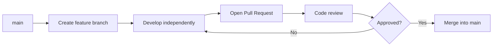
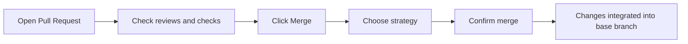
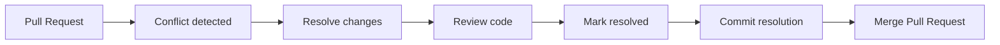

# GitHub – Interface Guide

## 1. Repository Navigation

| Tab | What you can do |
|---|---|
| 📁 **Code** | Browse files, folders and branches |
| 📝 **Issues** | Track bugs, tasks and feature requests |
| 🔀 **Pull Requests** | Review and merge proposed changes |
| ⚙️ **Actions** | Monitor automated workflows |
| 📋 **Projects** | Organise tasks and project progress |
| 📊 **Insights** | Explore repository activity |
| 🔧 **Settings** | Manage permissions and configurations |

---

## 2. Branches – Organising Development

Branches allow developers to work independently without directly modifying the main version of a project.

### Why use branches?

- Protect the stability of the main codebase.
- Develop new features independently.
- Test changes before integrating them.
- Fix bugs without affecting ongoing development.
- Enable collaboration and code reviews.

### Typical branch types

| Branch | Objective |
|---|---|
| `main` | Stable, production-ready code |
| `develop` | Integrates ongoing development (if used) |
| `feature/...` | Develop new functionality |
| `bugfix/...` | Fix existing issues |
| `hotfix/...` | Fix urgent production problems |

### Branch workflow



### Create a branch

**Navigation:** `Repository → Code → Branch selector → Create branch`

1. Open the repository's **Code** tab.
2. Click the branch selector (usually showing `main`).
3. Enter a new branch name.
4. Select the base branch.
5. Click **Create branch**.

Example: `feature/data-cleaning`, created from `main`.

### Switch between branches

1. Open **Code**.
2. Click the branch selector.
3. Search for the branch.
4. Select its name.

> **Note:** Switching branches in GitHub changes the version you're viewing in the browser. It does not switch your local VS Code branch.

---

## 3. Pull Requests – Proposing Changes

A Pull Request (PR) is a proposal to integrate changes from one branch into another.

### Create a Pull Request

**Navigation:** `Repository → Pull Requests → New pull request`

1. Select the branches:

| Field | Meaning | Example |
|---|---|---|
| **Base** | Destination branch | `main` |
| **Compare** | Source branch containing changes | `feature/data-cleaning` |

2. Review the differences.
3. Click **Create pull request**.
4. Add a descriptive title and explanation.
5. Assign reviewers if required.
6. Submit the PR.

### Review a Pull Request

| Section | Purpose |
|---|---|
| Conversation | Discuss proposed changes |
| Commits | Inspect individual commits |
| Files changed | Review modifications line by line |

**Available review actions:**

- **Approve:** Accept the proposed changes.
- **Request changes:** Ask for modifications.
- **Comment:** Provide feedback.

---

## 4. Merge – Integrating Changes

Once a Pull Request is reviewed and approved, its changes can be merged into the destination branch.

### Merge workflow



### Merge strategies

| Strategy | How it works | Best for |
|---|---|---|
| **Merge commit** | Combines branches and preserves their history | Maintaining full development history |
| **Squash and merge** | Combines all branch commits into one | Keeping the main history clean |
| **Rebase and merge** | Replays commits onto the base branch | Maintaining linear history |

### Visual comparison

**Merge commit**

```text
A ── B ── C ──────── M
      \             /
       └── D ── E ─┘
```

**Squash and merge**

```text
A ── B ── C ── S
```

**Rebase and merge**

```text
A ── B ── C ── D' ── E'
```

### Merge through GitHub

1. Open the Pull Request.
2. Check that required reviews and automated checks have passed.
3. Click **Merge pull request**.
4. Select the merge strategy.
5. Confirm the merge.

> **Note:** The available strategies depend on repository settings. GitHub may also offer the option to delete the source branch after merging.

---

## 5. Merge Conflicts

A merge conflict occurs when GitHub cannot automatically combine changes between branches.

**Example:** Two developers modify the same lines in the same file.

### Resolution workflow



GitHub offers a **Resolve conflicts** editor for supported conflicts. More complex conflicts must be resolved locally in VS Code.

---

## 6. Repository Permissions

**Navigation:** `Repository → Settings → Collaborators`

| Permission | Access level |
|---|---|
| Read | View project content |
| Triage | Manage issues and discussions |
| Write | Contribute to the repository |
| Maintain | Manage repository operations |
| Admin | Full repository control |

---

## 7. Quick Reference

| I want to... | Where to go |
|---|---|
| Browse project files | Code |
| View another branch | Code → Branch selector |
| Create a branch | Code → Branch selector → Create |
| Propose changes | Pull Requests → New |
| Review changes | Pull Requests → Files changed |
| Approve a proposal | Pull Requests → Review changes |
| Integrate changes | Pull Requests → Merge |
| Manage collaborators | Settings → Collaborators |
| Check automation | Actions |

## Useful Resources

- [GitHub Documentation](https://docs.github.com/)
- [GitHub Skills](https://skills.github.com/)
- [Managing Branches](https://docs.github.com/en/repositories/configuring-branches-and-merges-in-your-repository/managing-branches)
- [Pull Requests](https://docs.github.com/en/pull-requests)
- [Merge Strategies](https://docs.github.com/en/pull-requests/collaborating-with-pull-requests/incorporating-changes-from-a-pull-request/about-pull-request-merges)

---

**Key concept:** Branches isolate development, Pull Requests enable review, and merging integrates approved changes.